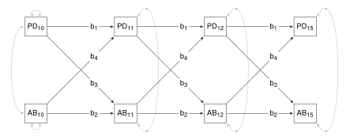
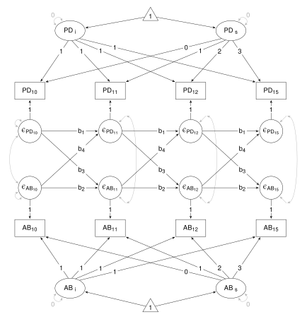
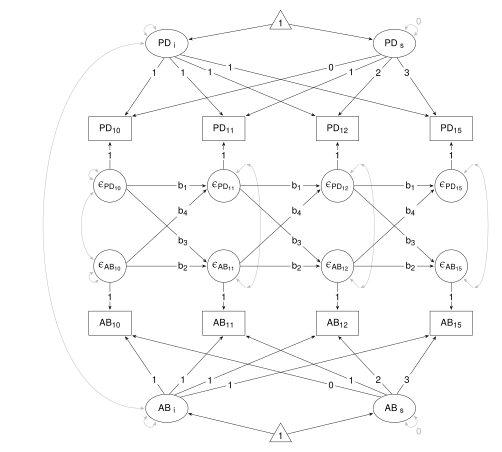

Berry, D., & Willoughby, M. (2016). On the practical interpretability of cross-lagged panel models: Rethinking a developmental workhorse. *Child Development*, *88*(4), 1186-1206.


This example shows how to fit an Autoregressive Cross-Lagged Panel model (ARCL) and an Autoregressive Latent Trajectory Model with Structured Residuals (ALT-SR) using **lavaan**. Commencing on page 1198, Berry & Willoughby (BW) discuss results of two empirical examples of data fit to ARCL and ALT-SR models.  The first fits summary data reported in:

Lansford, E., Criss, M., Laird, R., Shaw, D., Pettit, G., Bates, J., & Dodge, K. (2011). Reciprocal relations between parents' physical discipline and children's externalizing behavior during middle childhood and adolescence. *Development and Psychopathology*, *23*(1), 225–238.

Their second example fits raw data from the *Family Life Project*, but, as far as I know, the raw data is not available. Thus, in my **lavaan** code (see below), I fit the summary data reported by BW in their *Online Supplemental Material*. Both examples are concerned with disaggregating between-person and within-person effects in studies of the reciprocal relations between parents' physical discipline and children's antisocial behavior. 

### Example 1

#### Load package and get the data

The data are available in Lansford et al: Table 4 (p. 232) contains means and standard deviations, and Table 5 (p. 232) contains correlations. Or, the data are available in BR's Online Supplemental Material: Appendix S3 (p. 10).

Lansford et al's variable names are 'Parental Descipline' (PD) and 'Antisocial Behaviour' (AB).
BW use the terms 'Spanking' and 'Aggression', and their variable labels are 'Spank' and 'Agg'.
I use Lansford et al's original labels: 'PD' for Parental Discipline, and 'AB' for Antisocial Behaviour.

```{r}
#| file: "R/Example1_data.r"
``` 

 
#### Cross-lagged Panel Model (CLPM)

In Figure 1 (p. 1187), BW present the path diagram for a prototypical ARCL (Lansford et al would call it a cross-lagged model, or possibly a cross-lagged panel model). I reproduce the diagram below but for a model applied to Lansford et al's data. Lansford et al fit a range of models, but this is not one of them. Some points to note about the model:  

- The stability effects within variables (b~1~ and b~2~) constrained to equality;
- Cross-lagged effects PD to AB (b~3~) constrained to equality;
- Cross-lagged effects AB to PD (b~4~) constrained to equality;
- Residual variances constrained to equality within variables for ages 11, 12, and 15;
- Concurrent covariances are constrained to equality for ages 11, 12, and 15.

  

Setup and fit the model, and get the summary. Note that I use the `lavaan()` function to fit the model, though the `sem()` function gives the same results.

```{r}
#| file: "R/Lansford_Study2.r"
```


#### Autoregressive Cross-Lagged model (ARCL)

BW do not provide a path diagram for their ARCL model, but working backwards from their ALT-SR model, I think the path diagram below represents their ARCL model. Note that stability and cross-lagged effects (b~1~, b~2~, b~3~, and b~4~) operate among the structured residuals, not the measured variables. The same constraints apply to these effects as applied in the CLPM. Also the same constraints apply to the variances and covariances of the residuals of the structured residuals. Though the means for the intercepts and the slopes of AB and PD (PD~i~, PD~s~, AB~i~, and AB~s~) are estimated, they are not random effects (i.e., their variances are constrained to zero). 

  

Setup and fit the model, and get the summary. In **lavaan**, structured residuals are setup as latent variables (for example, `r.AB10 =~ 1*AB10`). Thus, effects among the structured residuals (such as stability and cross-lagged effects) can be estimated. 

Again, I use the `lavaan()` function. The function turns off estimation of means, intercepts, variances and covariances, then in the model statement, I turn on only those needed . Alternatively, I could use the `sem()` or `growth()` functions - they turn on estimation of some means, intercepts, variances and covariances, which then have to be turned off in the model statement, but which ones get turned on, and therefore which ones need to be turned off? For me, easier to use `lavaan()`.

Compare the results with the ARCL results in Table 2 (p. 1200).

```{r}
#| file: "R/Example1_ARCL.r"
```


#### Autoregressive Latent Trajectory Model with Structured Residuals (ALT-SR)

The path diagram is given in Figure 4 (p. 1896), reproduced below. The variance for the intercepts for AB and PD (AB~i~ and PD~i~) and their covariance are estimated, but the slope variances (AB~s~ and PD~s~) remain constrained to zero.

  

Setup and fit the model, and get the summary. Compare the results with the ALT-SR results in Table 2 (p. 1200).

```{r}
#| file: "R/Example1_ALTSR.r"
```


### Example 2

